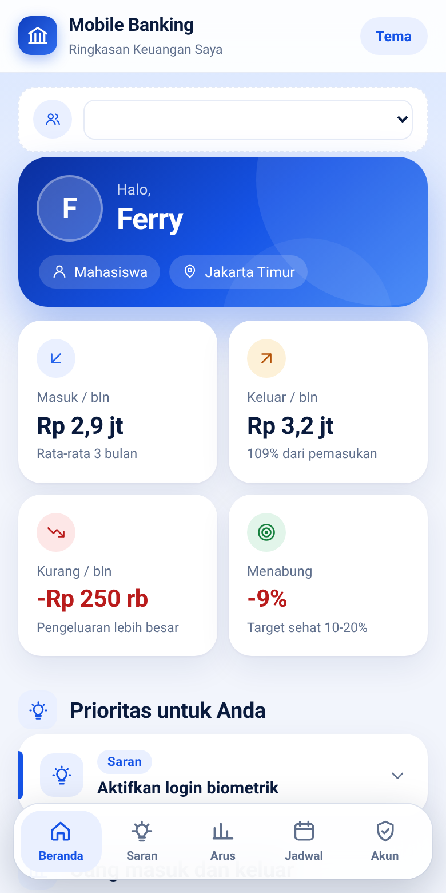
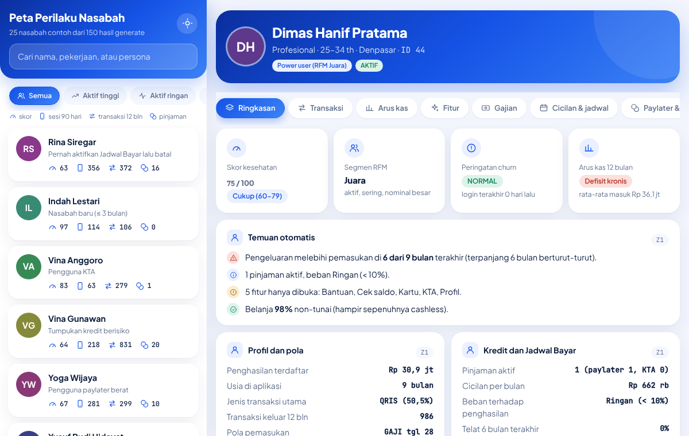
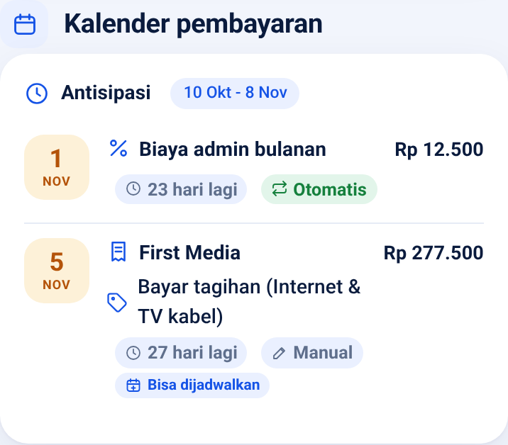
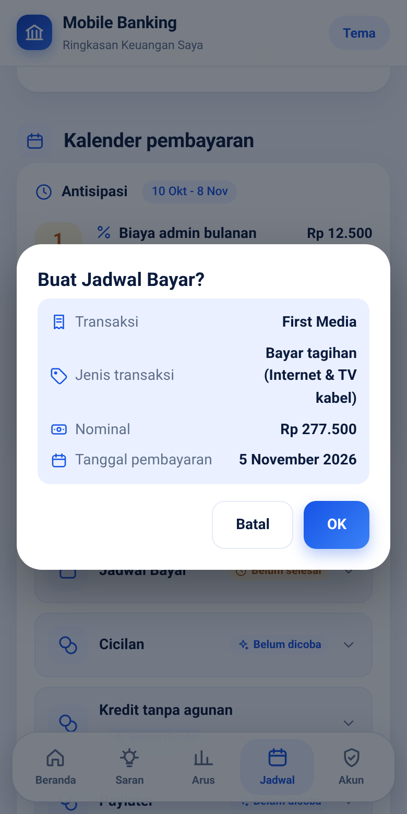
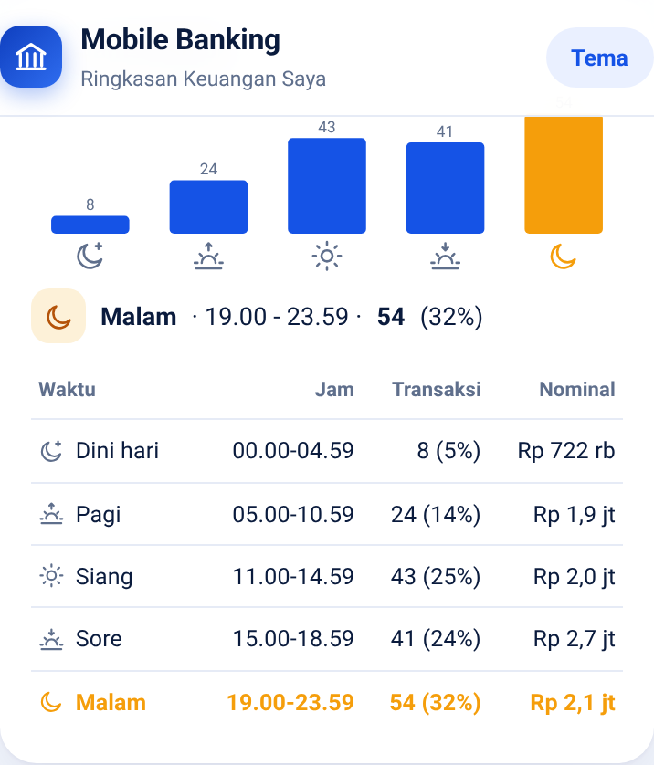

# Mobile Banking Dummy: Generator Data dan Analitik Perilaku Nasabah

Proyek portofolio data engineering. Saya membangun **generator data dummy mobile banking** untuk PostgreSQL, **46 query analitik per nasabah**, dan **dua halaman web** yang menampilkan hasilnya dari sisi nasabah dan sisi bank. Semua data fiktif.

| Sisi nasabah: "Ringkasan Keuangan Saya" | Sisi bank: "Peta Perilaku Nasabah" |
|---|---|
|  |  |

## Apa yang ditunjukkan proyek ini

- **Pemodelan data dan simulasi.** 20 tabel PostgreSQL dengan aturan bisnis yang saling terkait: gaji dan THR, tagihan rutin, cicilan Paylater dan KTA, Jadwal Bayar, biaya admin, bunga tabungan, dan nasabah yang berhenti memakai aplikasi secara bertahap.
- **SQL analitik tingkat lanjut.** 46 query (kelompok A sampai I, plus Customer 360 di Z1) dengan CTE, window function, view bantu, segmentasi RFM, peringatan churn, dan skor kesehatan keuangan.
- **Dari data ke produk.** Hasil query diubah menjadi rekomendasi berbasis aturan untuk nasabah, dan menjadi peta perilaku untuk analis bank.
- **Front-end tanpa dependensi.** Satu file HTML per halaman (data, CSS, JS, dan font tertanam) dengan tampilan bergaya aplikasi mobile banking beraksen biru: app bar, kartu ringkasan bergradasi, navigasi tab di bawah, responsif, mode gelap, dan bisa dipakai offline sebagai PWA.

## Isi repo

```
generator/generate_mobile_banking.py   generator data (Python 3.8+, tanpa pip install)
sql/analisis_behaviour_per_nasabah.sql  46 query analitik + view bantu
src/                                    sumber halaman web (template, data, font, build.py)
docs/                                   halaman web hasil build (GitHub Pages) + PWA
  index.html  nasabah.html  bank.html  sw.js  manifest.webmanifest  icons/  img/
```

## Cara menjalankan

Butuh Python 3.8+ dan PostgreSQL 13+ (saya uji di PostgreSQL 16).

```bash
# 1) Buat data (150 nasabah, seed tetap: hasil selalu sama)
python3 generator/generate_mobile_banking.py --customers 150 --seed 2026 --out mobile_banking.sql

# 2) Muat ke PostgreSQL (skema "mbanking")
createdb mbanking
psql -d mbanking -f mobile_banking.sql

# 3) Jalankan analitik (membuat view v_* dan hasil per nasabah)
psql -d mbanking -f sql/analisis_behaviour_per_nasabah.sql
```

Opsi generator: `--customers`, `--seed`, `--intensity` (pengali aktivitas), `--start`, `--end`, `--out`, `--load <db>` (langsung memuat ke database).
Data dengan 150 nasabah dan seed 2026 berisi sekitar **579 ribu baris** (145 ribu transaksi, 290 ribu event aplikasi, 123 ribu log login, 692 pinjaman) dengan periode 1 Jan 2024 sampai 9 Okt 2026. Saya menjalankan generator dua kali dengan argumen yang sama dan hasilnya identik byte per byte.

Untuk melihat satu nasabah saja:

```sql
SET search_path = mbanking, public;
SELECT * FROM ( /* salin query mana saja dari file analitik */ ) q WHERE customer_id = 44;
```

## Data yang disimulasikan

Nasabah, rekening (utama dan tabungan), kartu debit (VISA, Mastercard, GPN), pengguna aplikasi, perangkat, penerima transfer, dan:

- **Pemasukan:** gaji (tanggal gajian per perusahaan, mundur ke hari kerja sebelumnya), THR, uang saku, penghasilan tidak tetap, bunga tabungan bulanan.
- **Pengeluaran:** QRIS, e-wallet, transfer sesama bank dan antarbank, tagihan, pulsa, tarik tunai, kartu (gesek, contactless, online, luar negeri), serta langganan bulanan, dengan pola jam, hari, gajian, dan musim.
- **Pembayaran rutin:** kos, arisan, internet, BPJS, asuransi, multifinance, dan biaya admin bulanan (ditagih begitu saldo cukup).
- **Kredit:** Paylater dan KTA (pengajuan, persetujuan, pencairan, cicilan, telat, gagal bayar).
- **Jadwal Bayar:** dibuat dan dibatalkan, dijalankan otomatis, gagal karena saldo kurang, atau jatuh ke manual.
- **Aplikasi:** log login, event layar (dibuka vs benar-benar dipakai), notifikasi push, gangguan layanan.
- **Konsistensi demografi:** pekerjaan memiliki batas usia minimum, "Ibu Rumah Tangga" hanya untuk perempuan, nama depan dan belakang berbeda, dan rekening tujuan transfer diturunkan secara deterministik dari nama penerima.

## Analitik (`sql/`)

Prinsipnya: **setiap query mengembalikan baris per nasabah**, dengan `customer_id`, `full_name`, `occupation` sebagai kolom awal. Ringkasan lintas nasabah tinggal `GROUP BY` dari hasilnya.

| Kelompok | Isi |
|---|---|
| A | Jenis dan waktu transaksi |
| B | Pemasukan vs pengeluaran, arus kas |
| C | Fitur: dipakai vs hanya dibuka, adopsi, sesi |
| D | Gajian dan perilaku di sekitar gajian |
| E | Cicilan dan pembayaran rutin |
| F | Jadwal Bayar |
| G | Paylater dan KTA |
| H | Kartu, Visa, cashless |
| I | Engagement, siklus hidup, login, notifikasi, kegagalan, RFM, churn, perangkat, skor kesehatan |
| Z1 | Customer 360 (gabungan semua di atas) |

## Halaman web (`docs/`)

Kedua halaman memakai **snapshot 25 nasabah yang dipilih beragam** dari 150 hasil generate (data tertanam di HTML, tidak memanggil database).

**Ringkasan Keuangan Saya** (sisi nasabah), bahasa sehari-hari dan fokus pada tindakan:
- Prioritas dan saran berbasis aturan dari aktivitas 3 bulan terakhir.
- Uang masuk dan keluar 3 bulan terakhir (dengan nominal per batang), rincian pengeluaran per periode (3 bulan atau per bulan).
- **Antisipasi** pembayaran 30 hari ke depan (cicilan, tagihan, langganan, transfer rutin) lengkap dengan jenis transaksi dan rekening tujuan, serta popup konfirmasi Jadwal Bayar.
- Grafik jam tersibuk bertransaksi.
- **Fitur yang belum dicoba** dengan panduan singkat mengaktifkannya (bagian ini disembunyikan jika semua fitur sudah dicoba).

**Peta Perilaku Nasabah** (sisi bank): daftar nasabah dengan persona, pencarian dan filter, serta detail per nasabah (skor kesehatan, RFM, peringatan churn, arus kas, gajian, kredit, kartu, dan engagement) yang mengacu ke kode query asalnya (A1 sampai Z1).

| | | |
|---|---|---|
|  |  |  |

### Offline (PWA)

Semua aset tertanam di tiap file, termasuk font, jadi halaman bisa dibuka **langsung dari file** tanpa internet. Lewat GitHub Pages, `sw.js` menyimpan semua halaman pada kunjungan pertama sehingga berikutnya bisa dibuka offline dan dipasang ke layar utama. Setelah mengubah halaman, jalankan `python3 src/build.py` (otomatis menaikkan `VERSION` di `sw.js`).

### Mengaktifkan GitHub Pages

Settings → Pages → Deploy from a branch → branch `main`, folder **`/docs`**.

## Mengubah tampilan (`src/`)

`docs/nasabah.html` dan `docs/bank.html` adalah **hasil build**: data dan font sudah tertanam sehingga file-nya besar. Jangan diedit langsung. Sumber yang bersih ada di `src/`:

```
src/templates/nasabah.html   halaman nasabah (HTML + CSS + JS)
src/templates/bank.html      halaman bank
src/data/*.json              snapshot 25 nasabah (hasil query analitik)
src/fonts/*.woff2            Roboto, Plus Jakarta Sans, JetBrains Mono (ditanam saat build)
src/build.py                 template + data + font -> docs/*.html
src/tools/icons.py           daftar ikon SVG (sumber sprite ikon di template)
```

Tiga bahasa yang dipakai, semuanya berjalan di browser:

| Ingin mengubah | Bahasa | Di mana |
|---|---|---|
| Susunan dan isi (bagian, kartu, popup) | HTML | badan template, dan potongan HTML di fungsi JS |
| Warna, ukuran, jarak, mode gelap | CSS | blok `<style>`; warna utama ada di `:root{--acc:...}` |
| Perilaku, grafik, aturan saran | JavaScript | blok `<script>` |

Alur kerja:

```bash
# 1) ubah src/templates/nasabah.html atau bank.html
# 2) bangun ulang (tanpa pip install; hanya Python 3)
python3 src/build.py
# 3) buka docs/nasabah.html di browser untuk melihat hasilnya
# 4) commit dan push
```

`build.py` otomatis menaikkan `VERSION` di `docs/sw.js` bila HTML berubah, supaya pengunjung lama mendapat versi baru (pakai `--no-bump` untuk menonaktifkannya).

Data di `src/data/` adalah snapshot tetap. Untuk memperbaruinya dari database sendiri, jalankan query di `sql/analisis_behaviour_per_nasabah.sql` untuk nasabah terpilih dan simpan hasilnya per kode query (A1 sampai Z1) sebagai JSON dengan struktur yang sama.

## Keputusan desain dan keterbatasan

- Generator memakai pustaka standar Python saja dan satu seed untuk hasil yang bisa direproduksi. Mengubah aturan yang memengaruhi saldo akan menggeser seluruh dataset, sehingga 25 nasabah contoh harus dipilih ulang.
- Rekomendasi di halaman nasabah berbasis aturan (bukan model machine learning), sengaja dibuat sederhana supaya mudah ditelusuri ke query asalnya.
- Halaman web adalah snapshot statis dari data hasil generate. Skrip yang membangun HTML dari hasil query belum disertakan di repo ini.
- Seluruh nama, rekening, dan transaksi adalah data fiktif. Nama bank asli hanya dipakai sebagai label.

## Teknologi

Python (standar), PostgreSQL 16, SQL (CTE, window function, view), HTML, CSS, dan JavaScript tanpa framework, serta Service Worker.
